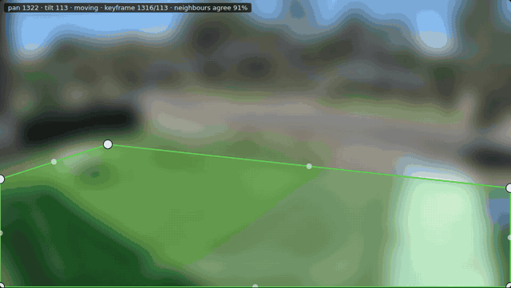
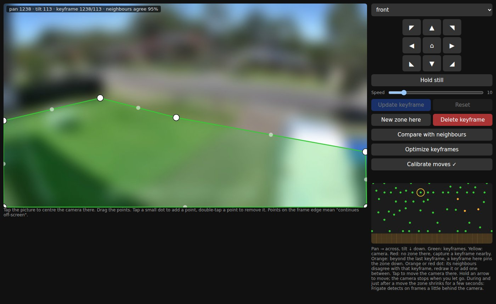

# frigate-ptz-zone

Keeps your Frigate zones in the right place when a PTZ camera turns.

## The problem

In Frigate you draw zones on the camera picture, for example around your driveway or front path. Frigate then alerts you when a person or car enters that area.

That works for a fixed camera. A PTZ camera turns, and when it does, the driveway moves across the picture. The zone stays where you drew it. Now it covers the neighbour's garden or the sky. You get alerts for the wrong things and miss the ones you wanted.

## What this does

It watches where the camera points and moves the zone with it. Wherever the camera looks, the zone stays on the driveway.

- Alerts work while the camera tracks someone or you turn it by hand.
- Where it has no zone for a view, it switches the zone off rather than guess. So a wrong zone never gives you false alerts.
- Optionally, it switches one of your Frigate motion masks on while the camera looks up. Drawn over the top of the picture, it stops swaying trees from counting as motion there.



*The camera picture is blurred for privacy.*

You set it up once. In a small web editor, turn the camera to a few positions and draw the zone at each. Each of these drawings is a **keyframe**. The service works out the views in between.

It doesn't matter what moves the camera: its own tracking, Frigate's autotracking, or you. Frigate's zones stay put in every case, so this helps in all of them. I built it for my own Reolink PTZ cameras, which track people by themselves.

## What you need

- Frigate. I run it on 0.18.
- A PTZ camera that can tell where it points. Reolink cameras work out of the box. Other makes need a small adapter (see [CONTRIBUTING.md](CONTRIBUTING.md)).
- On Reolink cameras, HTTPS switched on in the network settings. It is on by default.
- The zone created in Frigate. Draw it once in Frigate's UI, any shape. This service only moves it.

Every time the zone moves, Frigate saves it into its `config.yml`. That's normal.

## Install

Add the service to the `docker-compose.yml` that runs Frigate:

```yaml
  frigate-ptz-zone:
    image: ghcr.io/szsolt/frigate-ptz-zone:latest
    container_name: frigate-ptz-zone
    restart: unless-stopped
    depends_on:
      - frigate
    ports:
      - "8781:8781"   # the zone editor
    volumes:
      - ./ptz-zone:/data
    environment:
      FRIGATE_API: http://frigate:5000
      REOLINK_USER: admin
      REOLINK_PASSWORD: ${REOLINK_PASSWORD}
```

Then tell it about your camera in `./ptz-zone/cameras.json`. Use the camera name and zone name from Frigate:

```json
{
 "driveway": {
  "host": "192.0.2.10",
  "zone": "driveway_ground"
 }
}
```

Start it with `docker compose up -d frigate-ptz-zone`.

**Keep it on your LAN.** The editor has no login, and anyone who can open it can move your camera. Don't forward port 8781 to the internet.

**Frigate in a different compose file or on another machine?** Set `FRIGATE_API` to its address, for example `http://192.0.2.5:5000`. That port has no login either, so keep it on your LAN too.

**Updating:** `docker compose pull frigate-ptz-zone && docker compose up -d frigate-ptz-zone`.

## Set up a camera

### 1. Measure how the picture moves

The service needs to know how far the picture slides when the camera turns a little. A small tool measures that:

```sh
docker exec frigate-ptz-zone python3 -m frigate_ptz_zone.fit_shift driveway
```

Before you run it, point the camera at something with plenty of detail, like a house or a garden. Avoid plain sky and anything moving close by. The camera makes four small moves and comes back.

It shows each move, then a last line with `grid` and `shift`. Copy that line into the camera's entry in `cameras.json`, then restart: `docker restart frigate-ptz-zone`.

### 2. Draw keyframes

Open the editor at `http://<your docker host>:8781`.



- Turn the camera with the arrows, or tap the picture to centre the camera on that spot.
- Press **Hold still** first. It stops the camera from tracking people or returning home while you work. Tracking comes back on by itself 10 minutes after your last click.
- Drag the zone's points onto the ground you care about. Tap a small dot to add a point. Double-tap a point to remove it. A point on the picture's edge means "the zone continues off-screen".
- Press **Save keyframe**.

Repeat this at the views the camera usually visits.

The map under the buttons shows where you have keyframes:

- **Green dots** are your keyframes. **Yellow** is where the camera points now.
- **Red** areas have no zone: the zone is off there. Add a keyframe nearby if you need one.
- **Orange** areas are beyond your last keyframe. The zone is still shown there, but it's a guess. A keyframe there makes it exact.
- An **orange or red dot** is a keyframe that its neighbours disagree with. Redraw it, or add a keyframe in between.
- Tap the map to send the camera there.

When the zone shown somewhere looks wrong, just save a keyframe there.

### 3. Optional extras

- **Compare with neighbours:** on a keyframe, shows what the nearby keyframes would draw there, in blue. **Load their guess** copies that onto the points, so you can fix it up and save.
- **Optimize keyframes:** removes keyframes that the others already reproduce well. **Undo optimize** brings them back, until your next edit.
- **Calibrate moves:** the camera makes eight short moves. After that, tapping the picture centres the camera more precisely.
- **Lens fit**, for wide-angle cameras: once your keyframes cover most views, run
  ```sh
  docker exec frigate-ptz-zone python3 -m frigate_ptz_zone.fit_lens driveway
  ```
  It prints a `lens` line and a score against the plain setup. If the score is higher, add the `lens` line to `cameras.json` and restart.

### What to expect

While the camera moves, and a few seconds after, the zone shrinks to the area all recent views share. That's on purpose: Frigate looks at frames from a moment ago, so the zone has to fit those too.

## Settings

### cameras.json

One entry per camera. The key is the camera's name in Frigate.

| Key | What it does |
|-----|--------------|
| `zone` | The Frigate zone that follows the camera. Required. |
| `host` | The camera's address. |
| `type` | The kind of camera. Default `reolink`. |
| `position` | Reolink only: how the camera's position is read. `baichuan` (default) is Reolink's own protocol, the one Home Assistant uses. It's about 3× faster, and it works on models whose HTTPS reply has no tilt, like the TrackMix. `https` uses the web API. |
| `grid`, `shift` | How the picture moves when the camera turns. Printed by `fit_shift`. |
| `lens` | Lens correction for wide-angle cameras. Printed by `fit_lens`. Optional. |
| `keyframes` | The file the keyframes are saved in. Default `keyframes-<camera>.json`. |
| `max_dist` | How far from the nearest keyframe the zone still shows. Further away, it switches off. Default 260. |
| `agree` | How many nearby keyframes must agree on an area before it's part of the zone. Higher is stricter. Default 2. |
| `mask`, `mask_tilt` | A Frigate motion mask's name, and the tilt at which it switches on. The editor shows the camera's tilt. Set both or neither. |
| `pan_min`, `pan_max` | If the camera turns outside this range, it's sent back home. Optional; set both. |

### Environment variables

| Variable | Default | What it does |
|----------|---------|--------------|
| `FRIGATE_API` | `http://frigate:5000` | Where Frigate is. |
| `REOLINK_USER`, `REOLINK_PASSWORD` | | The login for your Reolink cameras. The same login for all of them. |
| `TZ` | UTC | Time zone for log times, for example `Europe/Berlin`. |
| `DATA_DIR` | `/data` in Docker | Where `cameras.json`, keyframes and learned values are kept. |
| `CAMERAS` | `$DATA_DIR/cameras.json` | Use a different camera file. |
| `EDITOR_PORT` | `8781` | The editor's port. |

## Without Docker

```sh
pip install ".[fit]"
DATA_DIR=./data python3 -m frigate_ptz_zone
```

## License

MIT. See [LICENSE](LICENSE).
